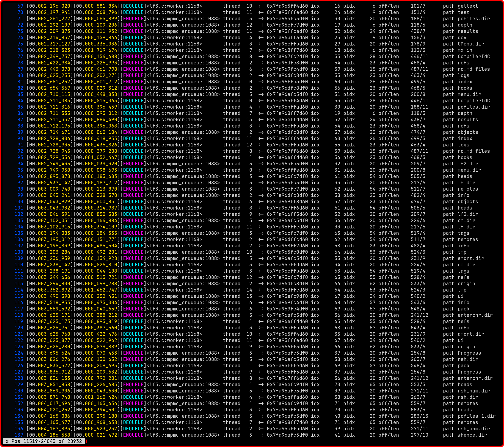

# lf

lf is a high performance file finder that can be used to generate file lists for pick, shell pipelines, or custom scripts. lf is comparable to the popular find command, but it is designed to be more user-friendly and ridiculously fast.

To say that lf is fast is understated. It is easily ten times faster than find, and, twice as fast as fd. lf handles huge directories with ease. It can be used to find files based on name, type, date, size, and other attributes, making it a powerful tool for file discovery and filtering. It also has an option that only reports cyclic and broken links.




Above is a screenshot of an lf debugging log in view. Notice that it uses a "Coders Timestamp" instead of the usual ISO_8601 timestamp. The Coders Timestamp is a pair of 64-bit integers that represent the number of milliseconds, microseconds, and nanoseconds elapsed since the program was started as well as an interval timer to track time between log entries. It is used for high-resolution timing and logging in lf, and it provides a far more precise measure of time than the standard ISO_8601 format. Most importantly, it contains meaningful information for developers who are debugging and profiling the performance of lf.

***NOTE:*** Each thread has it's own interval timer, so the Coders Timestamp is not a global timer. It is a per-thread timer that is used to track the time between log entries for each thread. This allows developers to see how long each thread is taking to execute, and to identify any threads that are taking longer than expected. The Coders Timestamp is a valuable tool for debugging and profiling the performance of lf, and it can help developers optimize their code for maximum performance.

lf is already incredibly fast, but because a file finder is a core component of applications that deal with large numbers of files, it is reasonable that there will be developers who find ways to make it even faster. Hopefully they will make their improvements part of the lf project.

lf is designed to be modular and extensible, so that it can be easily integrated into larger workflows and applications. It is also designed to be user-friendly, with a simple and intuitive interface that makes it easy to use for both novice and experienced users. We know you will be impressed with its speed, and we hope you will be just as impressed with its ease of use and flexibility. lf is a powerful tool for file discovery and filtering, and it is an essential component of the C-Menu toolkit.

## File Finder Comparative Benchmark

Below is the actual output of timings for find, fd, and lf on a directory with
511295 files. The directory is /home/bill, and it contains a mix of files and directories. The timings were done on a Linux system with a 16 x Intel® Xeon® E5-2670 @ 2.6GHz, 32GB of RAM, and an NVMe SSD.

# File Finder Benchmarks - November 22, 2026

* find (GNU findutils) version 4.11.0
* fd                   version 10.5.0
* lf                   version 0.3.3

Summary:

| Command               | Milliseconds | CPU% | Memory | Faults | Files   |
| --------------------- | ------------ | ---- | ------ | ------ | ------- |
| find /home/bill       | 850          | 99   | 35,500 | 11,893 | 511,296 |
| fd . -H -I /home/bill | 240          | 654  | 51,740 | 13,314 | 511,295 |
| lf -H /home/bill -T15 | 70           | 1026 | 18,824 | 865    | 511,295 |


NOTE: find counts the root directory as a file, while fd and lf do not. This
accounts for the one-file difference in the file counts. This is not necessarily
an error. Just subtract 1 from the find count to get an accurate result.

### Baseline find (GNU findutils) version 4.11.0

```
find /home/bill
find: ‘/home/bill/.config/google-chrome/BrowserMetrics’: Permission denied
0.36user 0.48system 0:00.85elapsed 99%CPU (0avgtext+0avgdata 35500maxresident)k
0inputs+0outputs (0major+11893minor)pagefaults 0swaps
found 511296 files
```
---

### Baseline fd version 10.5.0

```
fd . -H -I /home/bill
0.91user 0.69system 0:00.24elapsed 654%CPU (0avgtext+0avgdata 51740maxresident)k
0inputs+0outputs (0major+13314minor)pagefaults 0swaps
expected 511295 files, found 511295 files
```
---

### lf 6 threads

```
./lf -H /home/bill -T6
OPEN_FAIL,/home/bill/.config/google-chrome/BrowserMetrics,13:Permission denied
0.11user 0.37system 0:00.09elapsed 529%CPU (0avgtext+0avgdata 17316maxresident)k
0inputs+0outputs (0major+432minor)pagefaults 0swaps
expected 511295, found 511295 files
```
---

### lf 13 threads

---
```
./lf -H /home/bill -T13
OPEN_FAIL,/home/bill/.config/google-chrome/BrowserMetrics,13:Permission denied
0.18user 0.56system 0:00.07elapsed 957%CPU (0avgtext+0avgdata 18312maxresident)k
0inputs+0outputs (0major+782minor)pagefaults 0swaps
expected 511295, found 511295 files
```
---

### lf 15 threads

```
./lf -H /home/bill -T15
OPEN_FAIL,/home/bill/.config/google-chrome/BrowserMetrics,13:Permission denied
0.19user 0.62system 0:00.07elapsed 1026%CPU (0avgtext+0avgdata 18824maxresident)k
0inputs+0outputs (0major+865minor)pagefaults 0swaps
expected 511295, found 511295 files
```
------------------------------------------------

### lf 16 threads

```
./lf -H /home/bill -T16
OPEN_FAIL,/home/bill/.config/google-chrome/BrowserMetrics,13:Permission denied
0.16user 0.67system 0:00.08elapsed 1030%CPU (0avgtext+0avgdata 18780maxresident)k
0inputs+0outputs (0major+902minor)pagefaults 0swaps
expected 511295, found 511295 files
```
---

Note: Both find and lf indicate an error on
/home/bill/.config/google-chrome/BrowserMetrics, but fd does not.

fd ignores the error, while find and lf report the error to stderr so that it does not get mixed in with normal output on stdout. The error is a permission denied error, which means that the user running the command does not have permission to access the directory. This is helpful information for the user, as it indicates that there may be files in that directory that are not being counted.

## lf Quality Assurance

NOTE: lf has also been tested with -fsanitize=thread and -fsanitize=address, and no errors were found.

### Helgrind output

```
==792531== Helgrind, a thread error detector
==792531== Copyright (C) 2007-2026, and GNU GPL'd, by OpenWorks LLP et al.
==792531== Using Valgrind-3.29.0.GIT and LibVEX; rerun with -h for copyright info
==792531== Command: ./lf -H
==792531== Parent PID: 792529
==792531== 
==792531== 
==792531== Use --history-level=approx or =none to gain increased speed, at
==792531== the cost of reduced accuracy of conflicting-access information
==792531== ERROR SUMMARY: 0 errors from 0 contexts (suppressed: 135 from 10)
--792531-- 
--792531-- used_suppression:    135 helgrind-glibc2X-005 /usr/libexec/valgrind/default.supp:1022
==792531== 
==792531== ERROR SUMMARY: 0 errors from 0 contexts (suppressed: 135 from 10)
```

---

### Valgrind output

```
==797634== Memcheck, a memory error detector
==797634== Copyright (C) 2002-2026, and GNU GPL'd, by Julian Seward et al.
==797634== Using Valgrind-3.29.0.GIT- and LibVEX; rerun with -h for copyright info
==797634== Command: ./lf -H
==797634== Parent PID: 797632
==797634== ==797634== HEAP SUMMARY:
==797634==     in use at exit: 0 bytes in 0 blocks
==797634==   total heap usage: 60 allocs, 60 frees, 8,415,217 bytes allocated
==797634== 
==797634== All heap blocks were freed -- no leaks are possible
==797634== 
==797634== ERROR SUMMARY: 0 errors from 0 contexts (suppressed: 0 from 0)
```
---

## To Build lf

Change to the source directory, lf/src, and:

1. Generate the Build system inside the "build" folder.

```bash
cmake -B build -DCMAKE_BUILD_TYPE=Release
```

2. Compile the project

```bash
cmake --build build
```

3. Install the binaries (Default prefix is /usr/local)

```bash
sudo cmake --install build
```

- To change the installation path (the PREFIX variable from your Makefile), swap step 1 with:

```bash
    cmake -B build -DCMAKE_INSTALL_PREFIX=/your/custom/path.
```

- To build a Debug variant, toggle the build flag: 

```bash
cmake -B build -DCMAKE_BUILD_TYPE=Debug
```

- To run valgrind:

```bash
cmake --build build --target valgrind
```

- To run helgrind:

```bash
cmake --build build --target helgrind
```

