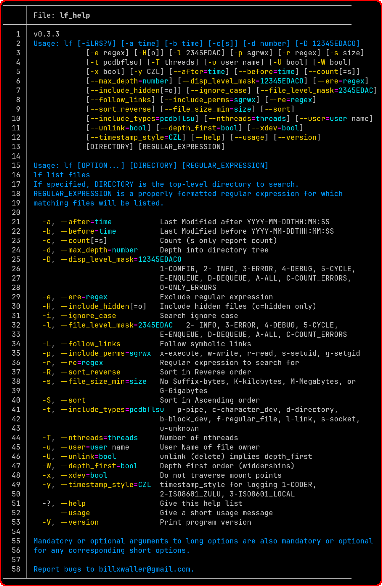

# lf

lf is a high performance file finder that can be used to generate file lists for pick, shell pipelines, or custom scripts. lf is comparable to the popular find command, but it is designed to be more user-friendly and ridiculously fast.

To say that lf is fast is understated. It is easily ten times faster than find, and, twice as fast as fd. lf handles huge directories with ease. It can be used to find files based on name, type, date, size, and other attributes, making it a powerful tool for file discovery and filtering. It also has an option that only reports cyclic and broken links.




Above is a screenshot of an lf debugging log in view. Notice that it uses a "Coders Timestamp" instead of the usual ISO_8601 timestamp. The Coders Timestamp is a pair of 64-bit integers that represent the number of milliseconds, microseconds, and nanoseconds elapsed since the program was started as well as an interval timer to track time between log entries. It is used for high-resolution timing and logging in lf, and it provides a far more precise measure of time than the standard ISO_8601 format. Most importantly, it contains meaningful information for developers who are debugging and profiling the performance of lf.

***NOTE:*** Each thread has it's own interval timer, so the Coders Timestamp is not a global timer. It is a per-thread timer that is used to track the time between log entries for each thread. This allows developers to see how long each thread is taking to execute, and to identify any threads that are taking longer than expected. The Coders Timestamp is a valuable tool for debugging and profiling the performance of lf, and it can help developers optimize their code for maximum performance.

lf is already incredibly fast, but because a file finder is a core component of applications that deal with large numbers of files, it is reasonable that there will be developers who find ways to make it even faster. Hopefully they will make their improvements part of the lf project.

lf is designed to be modular and extensible, so that it can be easily integrated into larger workflows and applications. It is also designed to be user-friendly, with a simple and intuitive interface that makes it easy to use for both novice and experienced users. We know you will be impressed with its speed, and we hope you will be just as impressed with its ease of use and flexibility. lf is a powerful tool for file discovery and filtering, and it is an essential component of the C-Menu toolkit.

## File Finder Comparative Benchmark

Below is the actual output of timings for find, fd, and lf on a directory with
465,412 files. The directory is /home/bill, and it contains a mix of files and directories. The timings were done on a Linux system with a 16 x Intel® Xeon® E5-2670 @ 2.6GHz, 32GB of RAM, and an NVMe SSD.


# File Finder Benchmarks - November 22, 2026

* find (GNU findutils) version 4.11.0
* fd                   version 10.5.0
* lf                   version 0.3.3

Summary:

| Command               | Milliseconds | CPU% | Memory | Faults | Files   |
| --------------------- | ------------ | ---- | ------ | ------ | ------- |
| find /home/bill       | 750          | 99   | 35,228 | 12,004 | 465,413 |
| fd . -H -I /home/bill | 240          | 586  | 51,336 | 13,531 | 465,412 |
| lf -H /home/bill      | 70           | 1069 | 19,008 | 872    | 465,412 |


NOTE: find counts the root directory as a file, while fd and lf do not. This
accounts for the one-file difference in the file counts. This is not necessarily
an error. Just subtract 1 from the find count to get an accurate result.

### Baseline find (GNU findutils) version 4.11.0

```
find /home/bill
0.33user 0.41system 0:00.75elapsed 99%CPU (0avgtext+0avgdata 35228maxresident)k
0inputs+0outputs (0major+12004minor)pagefaults 0swaps
found 465413 files
```

---

### Baseline fd version 10.5.0

```
fd . -H -I /home/bill
0.85user 0.59system 0:00.24elapsed 597%CPU (0avgtext+0avgdata 51336maxresident)k
0inputs+0outputs (0major+13531minor)pagefaults 0swaps
expected 465412 files, found 465412 files
```

---
### Baseline lf version 0.3.3

```
./lf -H /home/bill
0.21user 0.62system 0:00.07elapsed 1069%CPU (0avgtext+0avgdata 19008maxresident)k
0inputs+0outputs (0major+872minor)pagefaults 0swaps
expected 465412 files, found 465412 files
```

---

By default, fd ignores errors, while find and lf report errors to stderr so that they do not get mixed in with normal output on stdout. A permission denied error, for example,  means that the user running the command does not have permission to access the directory. This is helpful information for the user, as it indicates that there may be files in that directory that are not being counted.

## lf Quality Assurance

NOTE: lf has also been tested with -fsanitize=thread and -fsanitize=address, and no errors were found.

### Helgrind output

```
==792531== Helgrind, a thread error detector
==792531== Copyright (C) 2007-2026, and GNU GPL'd, by OpenWorks LLP et al.
==792531== Using Valgrind-3.29.0.GIT and LibVEX; rerun with -h for copyright info
==792531== Command: ./lf -H
==792531== Parent PID: 792529
==792531== 
==792531== 
==792531== Use --history-level=approx or =none to gain increased speed, at
==792531== the cost of reduced accuracy of conflicting-access information
==792531== ERROR SUMMARY: 0 errors from 0 contexts (suppressed: 135 from 10)
--792531-- 
--792531-- used_suppression:    135 helgrind-glibc2X-005 /usr/libexec/valgrind/default.supp:1022
==792531== 
==792531== ERROR SUMMARY: 0 errors from 0 contexts (suppressed: 135 from 10)
```

---

### Valgrind output

```
==797634== Memcheck, a memory error detector
==797634== Copyright (C) 2002-2026, and GNU GPL'd, by Julian Seward et al.
==797634== Using Valgrind-3.29.0.GIT- and LibVEX; rerun with -h for copyright info
==797634== Command: ./lf -H
==797634== Parent PID: 797632
==797634== ==797634== HEAP SUMMARY:
==797634==     in use at exit: 0 bytes in 0 blocks
==797634==   total heap usage: 60 allocs, 60 frees, 8,415,217 bytes allocated
==797634== 
==797634== All heap blocks were freed -- no leaks are possible
==797634== 
==797634== ERROR SUMMARY: 0 errors from 0 contexts (suppressed: 0 from 0)
```
---

## Building lf

---

Initial build:

Change to the source directory, lf/src, and:

1. Generate the Build system inside the "build" folder.

```bash
cmake -B build -DCMAKE_BUILD_TYPE=Release
```

2. Compile the project

```bash
cmake --build build
```

3. Install the binaries (Default prefix is /usr/local)

```bash
sudo cmake --install build
```

---

- To install lf in a custom path (the PREFIX variable from your Makefile), swap step 1 with:

```bash
    cmake -B build -DCMAKE_INSTALL_PREFIX=/your/custom/path \
          -DCMAKE_BUILD_TYPE=Release
```

---

- To build a Debug variant, toggle the build flag: 

```bash
cmake -B build -DCMAKE_BUILD_TYPE=Debug
```

---

Before running valgrind or helgrind, you must build the Debug variant of lf. This is because valgrind and helgrind require debug symbols to be present in the binary in order to provide meaningful output. If you try to run valgrind or helgrind on a Release build, you will get a lot of warnings and errors that are not relevant to your code.

- To run valgrind:

```bash
cmake --build build --target valgrind
```

- To run helgrind:

```bash
cmake --build build --target helgrind
```

After running helgrind, you will find helgrind.out in src/helgrind. Because the helgrind report is notoriously confusing and difficult to read, you can change to the src/helgrind directory and run the following command to get a more concise and readable report:

```bash
    ./fmt_helgrind.sh
```

This will create a file named helgrind_s1.out in the src/helgrind directory and make backup copies of lf.c and lf.h as lf_1.c and lf_1.h respectively. The numbers appended to the files increment sequentially for each iteration of fmt_helgrind.sh. This will be helpful in the event that your modifications have broken lf and you need to revert to a previous iteration.

```
Helgrind, a thread error detector
Copyright (C) 2007-2026, and GNU GPL'd, by OpenWorks LLP et al.
Using Valgrind-3.29.0.GIT and LibVEX; rerun with -h for copyright info
Command: ./lf -H
2026-11-23T16:32:24Z Condensed Format by Bill Waller

cntxt errors action size  at_addr by_addr fn                          thread  line
----- ------ ------ ---- -------- ------- ------------------------------ --- -----
    1      7 write     8  4AB22C8  4075EE mpmc_dequeue                     2  1200
    1        read                  40745E mpmc_dequeue                    16  1155
      ------
           7 total errors

line_no  errors Conflicts
-------  ------ -------------------------------------------------
   1155       7   1200
   1200       7   1155
         ------ 
total        14 (2 x 7) 
```

---

Note: You can build lf with a simple compile command such as:

```bash
clang -std=c23 lf.c -o lf
```

or

```bash
cc -std=gnu2y lf.c -o lf
```

However, you wont get the benefits of the CMake build system, such as easy configuration, dependency management, cross-platform support, integrated valgrind and helgrind actions, and language support.

The CMake build creates a file in the lf/src directory named compile_commands.json which is used by many IDEs and code editors to provide code completion, navigation, and other features. And, you can also use the CMake build system to generate project files for your IDE or code editor, so that you can use its built-in build and run features.

Therefore, it is recommended to use CMake for building lf, at least initially.
Once the compile_commands.json file is generated, you can use your favorite IDE
or code editor to build and run lf, and to debug and profile it. 

## Limitations

lf currently supports 1024 * 1024 = 1,048,576 directories, which should be equivalent to about 10 million files, assuming an average of 10 files per directory. This was a temporary compromise, resulting in a 4 Mb ring buffer that would comfortably fit in stack space, even on legacy systems, without pruning exhausted nodes. To take full advantage of the ring buffer topology, it is essential to prune exhausted nodes as they are encountered. This will allow lf to traverse a virtually unlimited number of directories, reduce the sequence array size, and improve performance. This work is underway, and it is expected to be completed in the near future. Once this work is completed, lf will be able to handle virtually unlimited numbers of directories and files, making it an even more powerful tool for file discovery and filtering.
